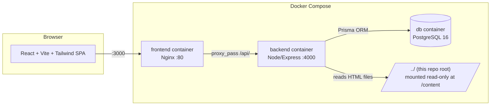

# MPPSC Prep Tracker — Study Content + Full-Stack Practice Application

This repository contains **MPPSC (Madhya Pradesh Public Service Commission) exam-preparation content**,
organized into 10 subject units, plus a **full-stack web application** (`mppsc-app/`) that turns that content
into an interactive study & practice tracker — with spaced-repetition revision, mock tests, bookmarks, search,
and progress statistics.

> TL;DR — to run the app: `cd mppsc-app && docker compose up --build`, then open http://localhost:3000 and
> click **"Import MCQ Content"** once. Full instructions in [Running the application](#running-the-application).

---

## 1. Repository contents

### 1.1 Study content (10 unit folders)

Each top-level folder is one subject **unit**, named `"<N>) <Hindi/English title>"`:

| # | Unit folder | MCQs imported |
|---|---|---:|
| 1 | मध्यप्रदेश का इतिहास, संस्कृति व साहित्य | 6,664 |
| 2 | भारत का इतिहास (प्राचीन–मध्यकाल–आधुनिक) | 5,240 |
| 3 | भारत व MP का भूगोल | 7,960 |
| 4 | संवैधानिक तंत्र (भारत + MP प्रशासन) | 6,382 |
| 5 | अर्थव्यवस्था (भारत + MP) | 7,366 |
| 6 | विज्ञान, टेक्नोलॉजी और सार्वजनिक स्वास्थ्य | 5,632 |
| 7 | पर्यावरण, जैवविविधता, SDGs व आपदा प्रबंधन | 6,430 |
| 8 | समसामयिकी (अंतरराष्ट्रीय/राष्ट्रीय/MP) | 4,795 |
| 9 | सूचना एवं संचार प्रौद्योगिकी (ICT) | 2,164 |
| 10 | MP की जनजातीय विरासत, लोक-संस्कृति व साहित्य | 4,412 |
| | **Total** | **57,045** |

Inside each unit folder there are dozens of **topic HTML files** (e.g. `उज्जैन — महाकाल कॉरिडोर — कला — व्याख्या.html`).
Each file is a self-contained, styled HTML page (viewable directly in a browser) that embeds its MCQ data as a
JavaScript object literal:

```html
<script>
  const RAW = {
    topic_title: "...",
    coverage_note: "...",
    vyakhya: "...",           // topic-level explanation/notes
    mcqs: [
      {
        question: "...",
        options: ["...", "...", "...", "..."],
        correct_answer_index: 2,   // also seen as answer_index / correctIndex / correct
        explanation: "...",
        priority_tag: "HIGH"        // VERY_HIGH | HIGH | MEDIUM | LOW
      },
      ...
    ]
  };
</script>
```

This RAW payload is what the application's importer parses to populate the database. **The original HTML
files are never modified** by the app — the backend only reads them (read-only volume mount).

### 1.2 The application (`mppsc-app/`)

A Dockerized full-stack app: React frontend, Express/TypeScript backend, PostgreSQL database. See the rest of
this document for full details, or [`mppsc-app/README.md`](mppsc-app/README.md) for a shorter quick-start.

---

## 2. Features

- 🏠 **Home dashboard** — total MCQs across all units and per-unit counts (the numbers in the table above,
  live from the database), attempted/accuracy, current streak, today's goal progress.
- 📚 **Unit & topic browsing** — drill into any unit to see its topics, per-topic question counts and accuracy.
- 📝 **Practice mode** — practice an entire unit or a single topic, shuffled, with instant right/wrong feedback
  and an expandable explanation panel per question.
- ⏱️ **Mock test mode** — timed test across one unit or all units, configurable question count and time limit,
  optionally filtered by priority tag (VERY_HIGH/HIGH/MEDIUM/LOW).
- 🔁 **Leitner spaced-repetition system** — every question has a "box" (1–5). Answer wrong → resets to box 1
  (resurfaces tomorrow). Answer right → box advances (resurfaces after 1 → 3 → 7 → 14 days). A **"Revision
  Due"** page lists everything scheduled for review right now.
- ❌ **Wrong-answers deck** — every question you've ever answered incorrectly, in one place, practiceable as a
  single deck.
- 🔖 **Bookmarks** — flag any question during practice (📑/🔖 icon) to revisit later from the Bookmarks page.
- 🔍 **Full-text search** — search MCQ text across all 57k+ questions, then practice just the matching results.
- 📊 **Statistics** — 90-day activity heatmap, accuracy-by-unit bar chart, accuracy-by-priority-tag chart.
- ⚙️ **Settings** — set your daily question goal, re-import content (safe/idempotent), reset all progress.
- 🌙 Dark mode, fully responsive UI, single-user local app (no login/auth needed).

---

## 3. Architecture



| Layer | Technology |
|---|---|
| Frontend | React 18 + TypeScript + Vite, TailwindCSS, React Router, TanStack Query, Axios, Recharts |
| Frontend server | Nginx (serves static build, reverse-proxies `/api/*` to backend) |
| Backend | Node.js 20 + Express 4 + TypeScript, Prisma ORM |
| Database | PostgreSQL 16 |
| Orchestration | Docker Compose (3 services: `db`, `backend`, `frontend`) |

### Folder structure

```
Structured-units/
├── 1) मध्यप्रदेश का इतिहास.../         ← study content (unit folders, untouched)
├── 2) भारत का इतिहास.../
├── ... (units 3–10)
└── mppsc-app/
    ├── docker-compose.yml           ← 3 services: db, backend, frontend
    ├── .env.example
    ├── backend/
    │   ├── Dockerfile
    │   ├── prisma/schema.prisma     ← DB schema (9 models)
    │   └── src/
    │       ├── index.ts             ← Express app bootstrap
    │       ├── db.ts                ← Prisma client
    │       ├── import/importContent.ts  ← HTML → DB importer
    │       ├── scripts/import.ts    ← CLI import entrypoint
    │       ├── utils/               ← leitner.ts, settings.ts, shuffle.ts, statsHelpers.ts
    │       └── routes/              ← units, topics, sessions, bookmarks, review, search, stats, settings, admin
    └── frontend/
        ├── Dockerfile / nginx.conf
        └── src/
            ├── api/client.ts        ← axios instance + TS types
            ├── components/          ← Layout, PriorityBadge, ProgressBar, StatCard, ReviewListPage, ...
            ├── hooks/                ← useDarkMode, useStartSession
            └── pages/                ← HomePage, UnitPage, MockSetupPage, PracticeSessionPage, ResultsPage,
                                          WrongDeckPage, DuePage, BookmarksPage, SearchPage, StatsPage, SettingsPage
```

---

## 4. Data model

Defined in [`mppsc-app/backend/prisma/schema.prisma`](mppsc-app/backend/prisma/schema.prisma):

| Model | Purpose |
|---|---|
| `Unit` | One of the 10 subject units (`code`, `name`, `orderIndex`) |
| `Topic` | One imported HTML file (`title`, `coverageNote`, `vyakhya`, unique `sourceFile` path) |
| `Question` | One MCQ (`questionText`, `options` JSON array, `correctIndex`, `explanation`, `priorityTag`); unique on `(topicId, orderIndex)` so re-imports update in place |
| `Session` | One practice/mock run (`mode`, optional `unitId`/`topicId`/`priorityFilter`, counters, `timeLimitSec`) |
| `Attempt` | One answer submitted during a session (`selectedIndex`, `isCorrect`, `timeTakenMs`) |
| `Bookmark` | A flagged question (unique per question) |
| `ReviewState` | Leitner tracking per question (`box` 1–5, `nextDueAt`, `timesWrong`, `timesCorrect`) |
| `DailyStat` | Per-day aggregate (questions attempted/correct/wrong, goal met) — powers streaks & heatmap |
| `Setting` | Key/value store (currently just `dailyGoal`) |
| `ImportLog` | History of importer runs (status, counts, warnings) |

Re-importing content **never deletes your progress**: questions are matched by `(topicId, orderIndex)` and
updated in place, so `Attempt`/`Bookmark`/`ReviewState` foreign keys stay valid.

### Leitner spaced-repetition rule

```
box:        1    2    3    4    5
interval:   0d   1d   3d   7d   14d   (days until next due, from the day you last answered)
```
- Correct answer → `box = min(box + 1, 5)`, `nextDueAt = today + interval[box]`.
- Wrong answer → `box = 1`, `nextDueAt = tomorrow`.

---

## 5. API reference (backend, base path `/api`)

| Router | Endpoints |
|---|---|
| `units` | `GET /units` (list + counts + stats), `GET /units/:id` (detail + topics + per-topic stats) |
| `topics` | `GET /topics/:id` (topic detail + full question list, with bookmark/review flags) |
| `sessions` | `POST /sessions` (start practice/mock/wrong-deck/due/bookmarks/custom session), `POST /sessions/:id/attempts` (submit an answer), `POST /sessions/:id/finish`, `GET /sessions/:id` (results), `GET /sessions?limit=` (history) |
| `bookmarks` | `GET /bookmarks`, `POST /bookmarks/:questionId/toggle` |
| `review` | `GET /review/wrong`, `GET /review/due`, `GET /review/counts` |
| `search` | `GET /search?q=&limit=` (full-text, case-insensitive) |
| `stats` | `GET /stats/overview`, `GET /stats/daily?days=`, `GET /stats/units`, `GET /stats/priority` |
| `settings` | `GET /settings`, `PUT /settings` |
| `admin` | `POST /admin/import`, `GET /admin/import/last`, `GET /admin/import/history`, `DELETE /admin/reset-progress` |

---

## 6. Running the application

### Prerequisites

- Docker Desktop (or Docker Engine + Compose plugin). Nothing else needs to be installed locally — Node/npm
  run only inside the containers.

### First-time setup

```bash
cd mppsc-app
docker compose up --build
```

This builds and starts 3 containers:
1. `db` — PostgreSQL 16, with a health check gating the backend's startup.
2. `backend` — runs `prisma db push` to create tables, then starts the API on port 4000 (internal).
3. `frontend` — Nginx serving the built React app on **http://localhost:3000**, proxying `/api/*` to the backend.

Open **http://localhost:3000**. The database starts empty, so:

- Click **"Import MCQ Content"** on the Home page, **or**
- Run it from the CLI: `docker compose exec backend npm run import`

> ⚠️ **The first import is slow** — it scans all ~1,745 HTML files and inserts ~57,000 questions one at a
> time, which takes roughly **15–20 minutes**. This is normal, not a hang. You can watch progress live:
> ```bash
> docker compose exec -T db psql -U mppsc -d mppsc -c "SELECT count(*) FROM \"Question\";"
> ```
> The count climbs steadily. You can also refresh the Home page at any time during the import to see units
> appear progressively (each unit's questions are committed as soon as that unit finishes). Re-imports (after
> the first one) are just as slow currently, since every question is still upserted individually — but they
> are safe to run any time and never lose your practice history.

### Everyday use

```bash
cd mppsc-app
docker compose up -d      # start in the background
docker compose down       # stop (keeps your data)
docker compose down -v    # stop AND delete the Postgres volume (full reset, re-import needed)
```

### Configuration

Copy `.env.example` to `.env` inside `mppsc-app/` to customize Postgres credentials (optional — sensible
defaults are used otherwise):

```bash
cd mppsc-app
cp .env.example .env
```

### Rebuilding after code changes

```bash
docker compose up --build
```

---

## 7. Troubleshooting

| Symptom | Cause / Fix |
|---|---|
| `prisma db push` fails with "Could not parse schema engine response" | Alpine image missing OpenSSL. Already fixed in `backend/Dockerfile` via `apk add --no-cache openssl`. |
| Import request returns a `504 Gateway Timeout` in the browser/curl | Nginx's proxy read timeout was hit, but the import **keeps running server-side** regardless. Poll `GET /api/admin/import/last` or query the DB directly instead of waiting on that one request. |
| Home page shows 0 units after `docker compose up` | Expected on first run — content hasn't been imported yet. See "First-time setup" above. |
| `git add` fails with "Filename too long" (Windows) | Some Hindi filenames exceed Windows' default path length. Run `git config core.longpaths true` once per repo. |

---

## 8. Notes

- This is a **single-user, local-only** app — there is no authentication, by design (per project requirements).
- The importer is read-only with respect to the original content folders; nothing in units 1–10 is ever modified.
- All practice history, bookmarks, and spaced-repetition schedule live only in the `db` container's Docker
  volume (`mppsc-app_db_data`) — back it up or `docker compose down -v` only when you intend a full reset.
